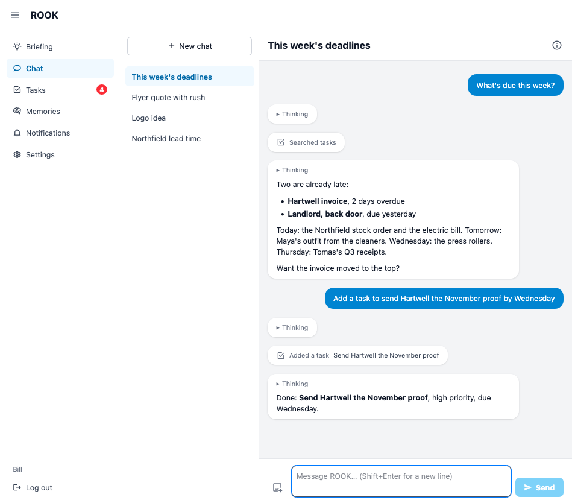
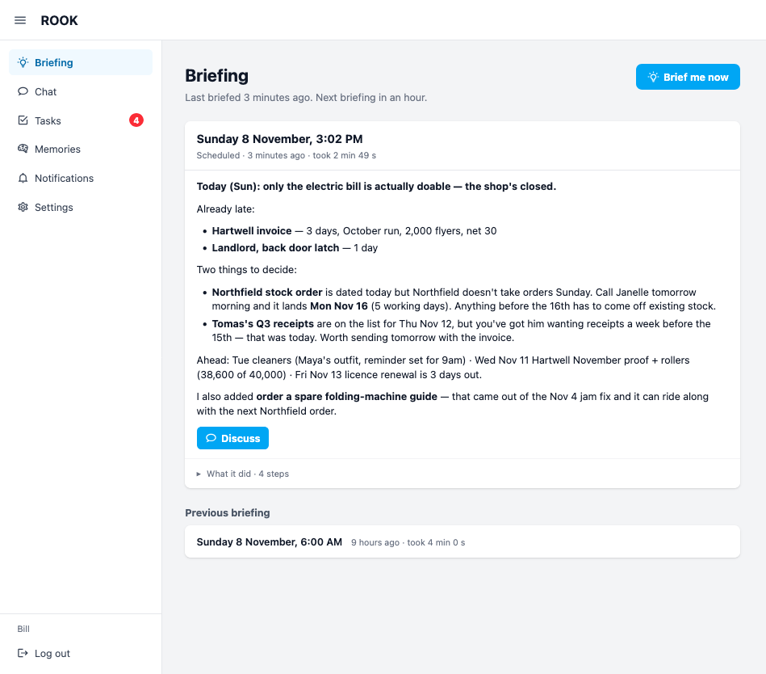
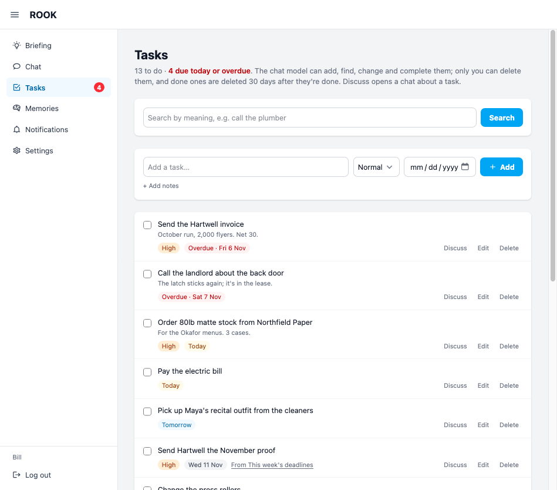
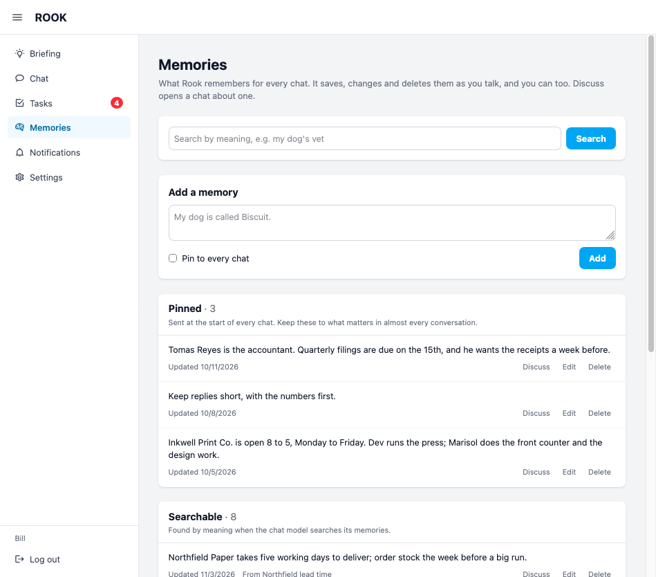

*The rook defends the king.*

[](https://github.com/internalfx/rook/actions/workflows/ci.yml)

**A personal assistant that lives on your hardware, runs on your models, and keeps your life in a file you own.**

ROOK remembers what you tell it, keeps your task list, reads your Slack, and checks in on you. Every few hours it looks over everything and writes you a briefing. It tidies up stale memories, marks off tasks your chats show are done, and adds the ones you mentioned in passing. When something matters later, like a deadline or a meeting, it schedules a push to your phone. Right before sending, it checks the reminder is still true.

All of it runs on a machine you control. The models run on your own [Lemonade](https://lemonade-server.ai) server, and each user's data sits in one SQLite file. **Nothing leaves your network** unless you've told ROOK it may search the web or read a site you've allowed.

- **Memories** it saves and finds by meaning, with the important ones pinned to every chat
- **Tasks** it adds, finds, updates and completes as you talk
- **Briefings** on a schedule, written from your memories, tasks, recent chats and Slack
- **Phone notifications** through [ntfy](https://ntfy.sh), checked by the model before they go out
- **Slack, read-only**, through each user's own token, so it only sees what they can
- **Web pages and search** on the sites you allow, plus arithmetic, dates and image generation
- **Multiple users**, each with their own data, on one install

No subscription, no cloud account, no one else's servers. Clone it, point it at your models, and it's yours.

| A chat, with the tools it used | A scheduled briefing |
|---|---|
|  |  |
| **Tasks** | **Memories** |
|  |  |

## Requirements

- [Bun](https://bun.sh) 1.2 or newer. ROOK uses Bun's SQLite and password hashing, so Node won't run it.
- A Lemonade server with a chat model loaded. Models that understand tool calls work best (Qwen 3 and the like). Optional models: an embedding model for memories and finding tasks by meaning, an image model for generating pictures, and a MinerU-HTML model for picking the main content out of web pages.
- For the web tools (reading pages, searching): a headless Chrome, installed once with

  ```sh
  bunx puppeteer browsers install chrome-headless-shell
  ```

## Install

```sh
git clone https://github.com/internalfx/rook.git
cd rook
bun install
bun run app
```

Open http://localhost:8005. The first visit is a short setup: it asks where your Lemonade server is, lets you choose models from what that server has, and makes your account, which is the admin's. Do it right away: until an account exists, anyone who can reach the server can make it.

The first start makes `data/rook.db` and builds the stylesheet. Nothing needs editing.

## Configuration

Two kinds of settings, in two places.

**The Admin pages**, in the app, hold what an admin may change while ROOK runs. Changes take effect at once; a reply already under way finishes as it started.

| Page | What's on it |
|---|---|
| Admin → Lemonade | The server's address, like `http://localhost:8000`, and an API key if it wants one. Check connection tries it before saving. |
| Admin → Models | Chat model (required; chats, briefings and the checks on scheduled notifications use it, and one that understands tool calls works best), embedding model (finds memories and tasks by meaning; memories need one), image model and size (or none), and a MinerU-HTML page reader that picks the main content out of web pages (or none). Everything the server has is listed underneath. |
| Admin → Tools | Tasks, memories, web search (through DuckDuckGo in a headless Chrome), and web pages on the sites you list. |
| Admin → Briefings | Scheduled briefings for every user, and how many minutes apart. |

**Environment variables** hold what's decided when ROOK is deployed. All are optional.

| Variable | Default | What it is |
|---|---|---|
| `ROOK_PORT` | `8005` | Where to listen |
| `ROOK_HOST` | `0.0.0.0` | The address to listen on; `127.0.0.1` for this machine only |
| `ROOK_ENV` | `development` | `production` sends the login cookie over HTTPS only, so it needs a TLS proxy in front |
| `ROOK_TRUST_PROXY` | `false` | `true` behind a reverse proxy, so the client address comes from `X-Forwarded-For` |
| `ROOK_DATA_DIR` | `data/` in the checkout | Where the database and images live |

A bad value stops the server at startup with a message saying what's wrong. A model that the Lemonade server doesn't have is only warned about, since the server may be down.

## Users

The setup wizard makes the first account, the admin's. There's no sign-up page: an admin adds the rest on Admin → Users, which also edits a name or email, resets a password, makes or unmakes an admin, and removes a user with everything that's theirs. Passwords need at least 10 characters. Admins get the Admin pages in the sidebar: Overview (how the Lemonade server and ROOK are doing), Users, and the settings above.

When no admin can log in, such as after a lost admin password, the same things can be done on the server:

```sh
bun scripts/users.js
```

Each user sets their own things in Settings: time zone, an ntfy topic for phone notifications, a Slack token and which conversations briefings should read.

To see ROOK with something in it before you've used it, add the demo user:

```sh
bun scripts/demo.js
```

That adds an account (demo@rook.local, with a password it prints) belonging to Bill, who runs a small print shop: chats, memories, tasks, a briefing and notifications, all made up and dated around today. Run it again for a fresh set, or with `--remove` to take the account away along with everything in it.

### ntfy

Install the [ntfy](https://ntfy.sh) app, subscribe to a topic of your own (a hard-to-guess name), and paste the topic URL into Settings, with an access token if your ntfy server needs one. The Notifications page has a test button.

### Slack

ROOK reads Slack with each user's own user token, so it only sees what that user can. Make a Slack app for your workspace, add these user token scopes, install it, and paste the `xoxp-` token into Settings:

`channels:history`, `channels:read`, `groups:history`, `groups:read`, `im:history`, `im:read`, `mpim:history`, `mpim:read`, `search:read`, `users:read`

The model then has `read_slack` and `search_slack`, which only read; it never posts. Briefings read the conversations picked in Settings.

## Running as a service

`deploy/rook.service` is a systemd unit to copy to `/etc/systemd/system/rook.service`; change its user and paths, then `systemctl enable --now rook`. `deploy.sh` updates such an install to the latest commit, backing up the database first.

For production, set `ROOK_ENV=production` and `ROOK_TRUST_PROXY=true` (the unit file has them), and put a TLS proxy such as Caddy or nginx in front, forwarding to the port. The login cookie is marked secure, so plain HTTP won't log anyone in.

Back up by copying `data/`: it holds the database (`rook.db`, in WAL mode, so copy it with `sqlite3 data/rook.db "VACUUM INTO 'backup.db'"` while running) and the images.

## Development

```sh
bun run dev        # the server, restarting when a file changes
bun run devcss     # Tailwind, rebuilding when a template changes
bun run lint
bun scripts/test-server.js   # a copy on :8015 with a copy of the database, for trying things
bun scripts/demo.js          # add or replace the demo user, for screenshots and a look around
```

STYLEGUIDE.md has the code conventions.

## Layout

- `services/` — code that runs on its own: the cron jobs in `cron.js` and what they start
- `lib/` — code shared across the app: the database and models, the Lemonade client, page helpers, prompts
- `routes/` — one file per URL; every `.js` here is a public route
- `middleware/` — the Koa middleware `substruct.js` loads
- `ai-tools/` — the tools the chat model can call
- `scripts/` — run by hand, e.g. `bun scripts/models.js`
- `migrations/` — numbered SQL files, applied in order on startup
- `templates/`, `static/`, `assets/` — Nunjucks pages, served files, Tailwind input

## Contributing

Issues and pull requests are welcome. For anything bigger than a fix, open an issue first so we
can talk it over. Before sending a pull request, run `bun run lint` and read STYLEGUIDE.md; CI
checks the lint and that a fresh clone still starts.

Security problems go through the Security tab, not the issue tracker: see SECURITY.md.

## License

MIT. See LICENSE. Code and assets from other projects are credited in THIRD_PARTY_NOTICES.md.
